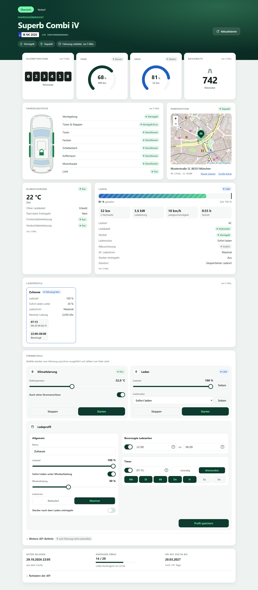
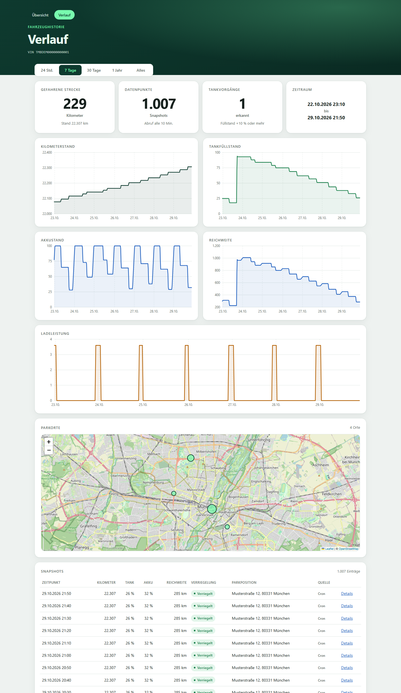
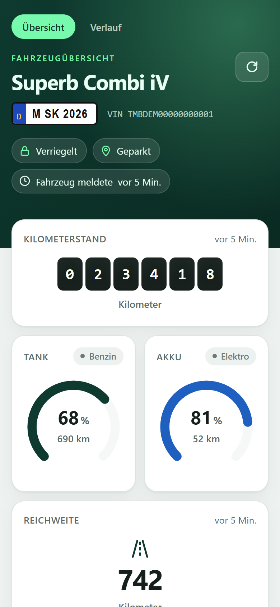
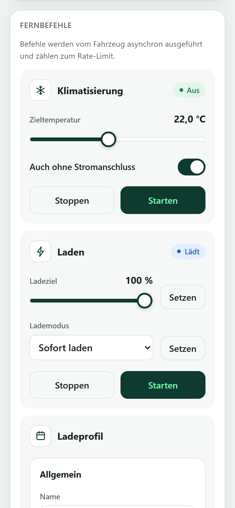
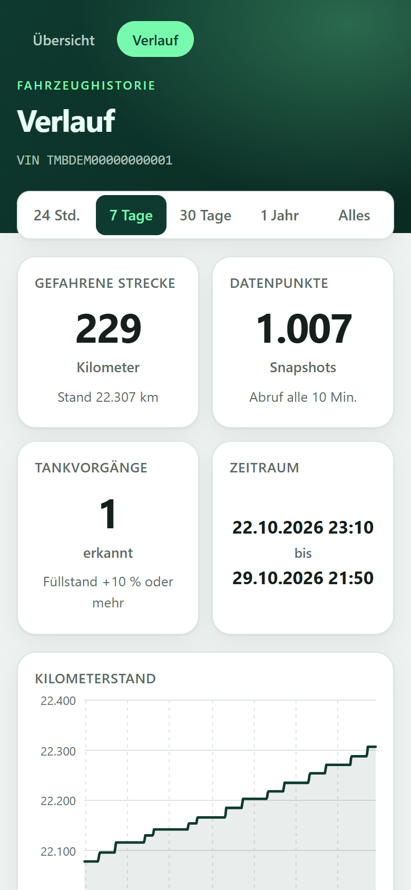
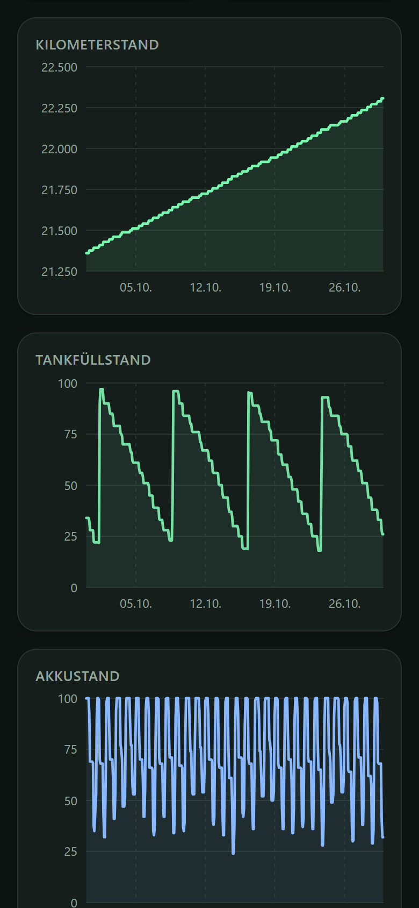

# Škoda Fahrzeugdaten · Škoda Vehicle Data

**[🇩🇪 Deutsch](#deutsch)** · **[🇬🇧 English](#english)** · [Lizenz / License: GPL-3.0-or-later](LICENSE)

Eine PHP-Weboberfläche für die offizielle MyŠkoda Public API, mit Fernbefehlen und Datenverlauf in SQLite oder MySQL.<br>
A PHP web interface for the official MyŠkoda Public API, with remote commands and data history in SQLite or MySQL.

## Screenshots

*Demodaten eines fiktiven Fahrzeugs · Demo data of a fictional vehicle*

### Desktop

| Übersicht · Dashboard | Verlauf · History |
|:---:|:---:|
|  |  |

### Smartphone

| Übersicht · Dashboard | Fernbefehle · Remote commands | Verlauf · History | Dunkelmodus · Dark mode |
|:---:|:---:|:---:|:---:|
|  |  |  |  |

---

<a id="deutsch"></a>

# 🇩🇪 Deutsch

Eine schlanke PHP-Weboberfläche für die offizielle **MyŠkoda Public API**. Sie zeigt den aktuellen Zustand
deines Škoda an (Kilometerstand, Tank-/Akkustand, Reichweite, Verriegelung, Türen und Fenster,
Parkposition, Klimatisierung, Laden, Ladeprofile). Fernbefehle lassen sich direkt auslösen. Ein Cronjob
speichert die Daten regelmäßig in einer Datenbank, und die Weboberfläche stellt sie als Verlauf dar.

- **Dashboard** mit allen Daten, die das Fahrzeug liefert, inklusive Karte der Parkposition
- **Fernbefehle**: Klimatisierung, Standheizung, aktive Lüftung, Laden, Ladelimit, Lademodus und Ladeprofile
  (müssen erst freigeschaltet werden)
- **Historie** in **SQLite** oder **MySQL/MariaDB**: Diagramme für Kilometerstand, Tank-/Akkustand,
  Reichweite und Ladeleistung, Karte der Parkorte, Tabelle aller Snapshots mit den Rohdaten
- **Konfigurierbarer Abruf**, standardmäßig alle 10 Minuten
- Läuft unter **Apache**, **nginx** und in **Docker**
- Responsiv für Desktop und Smartphone, mit hellem und dunklem Farbschema
- Keine Abhängigkeiten außer PHP-Erweiterungen, kein Composer und kein Build-Schritt

## API-Stand und Rate-Limit

Das Projekt basiert auf dem **API-Stand vom 29.10.2026**. Zu diesem Zeitpunkt bietet die API einen Lese-Endpoint
(`GET /api/v1/vehicles/{vin}`) und elf Fernbefehle. Alle sind hier umgesetzt.

- Dokumentation von Škoda: <https://public.api.connect.skoda-auto.cz/docs>
- API-Referenz (Swagger UI): <https://public.api.connect.skoda-auto.cz/docs/swagger-ui/index.html>

> **Rate-Limit:** Derzeit erlaubt die API **20 Anfragen pro Stunde und Fahrzeug (VIN)**. Laut Škoda ist
> dieser Wert noch nicht final und kann sich ändern. Fehlerantworten (z. B. 5xx) zählen mit, Antworten mit
> 401/403 nicht. Bei Überschreitung antwortet die API mit HTTP 429.

Damit das Kontingent reicht, wird jede Antwort zwischengespeichert (`var/cache`). Der Cronjob verbraucht
bei 10 Minuten Intervall 6 Anfragen pro Stunde. Für das Dashboard und Fernbefehle bleiben 14 übrig. Wenn
das Dashboard ohnehin frische Daten lädt, landen sie ebenfalls in der Historie, und der nächste Cron-Abruf
wird übersprungen. So geht keine Anfrage verloren.

## API-Key erzeugen

API-Keys werden ausschließlich in der **MyŠkoda-App** erstellt. Dafür brauchst du ein vernetztes Fahrzeug
und ein MyŠkoda-Konto.

1. Öffne auf dem Smartphone <https://go.skoda.eu/api-keys>. Der Link führt direkt zur API-Key-Verwaltung
   in der App. Am Computer kannst du stattdessen den QR-Code in der
   [Škoda-Dokumentation](https://public.api.connect.skoda-auto.cz/docs) scannen. Ist die App noch nicht
   installiert: <https://go.skoda.eu/myskoda>.
2. Lege einen neuen Key an und wähle die Fahrzeuge aus, für die er gelten soll. Der Key funktioniert nur
   für diese Fahrzeuge.
3. Kopiere den Key und trage ihn zusammen mit der VIN in die Konfiguration ein (siehe unten).

Keys laufen ab. Das Dashboard zeigt im Fußbereich an, bis wann der Key gültig ist (Header
`X-API-Key-Expires-At`). Ist er abgelaufen, antwortet die API mit HTTP 401. Dann einfach in der App einen
neuen Key erzeugen. Die API ist laut Škoda nur für die private, nicht kommerzielle Nutzung gedacht.

## Voraussetzungen

- PHP **8.1** oder neuer mit den Erweiterungen `curl`, `mbstring`, `json` und `pdo_sqlite` bzw. `pdo_mysql`
- Ein Webserver (Apache oder nginx mit PHP-FPM) **oder** Docker
- Optional: MySQL 8 / MariaDB 10.5 oder neuer

## Konfiguration

Die Standardwerte stehen in `config.php`. Eigene Werte gehören **nicht** dort hinein, sondern entweder

- in **`config.local.php`** (Vorlage: `config.local.example.php`), oder
- in **Umgebungsvariablen**, was vor allem für Docker praktisch ist (Vorlage: `.env.example`).

Reihenfolge: Standardwerte < Umgebungsvariablen < `config.local.php`.

```bash
cp config.local.example.php config.local.php
```

| Option                   | Umgebungsvariable              | Standard               | Beschreibung                                                                    |
|--------------------------|--------------------------------|------------------------|---------------------------------------------------------------------------------|
| `api_key`                | `SKODA_API_KEY`                | –                      | API-Key aus der MyŠkoda-App                                                     |
| `vin`                    | `SKODA_VIN`                    | –                      | 17-stellige Fahrgestellnummer                                                   |
| `commands_enabled`       | `SKODA_COMMANDS_ENABLED`       | `false`                | Fernbefehle freischalten                                                        |
| `spin`                   | `SKODA_SPIN`                   | leer                   | S-PIN für die Standheizung; leer bedeutet Abfrage im Browser                    |
| `timezone`               | `SKODA_TIMEZONE`               | `Europe/Berlin`        | Zeitzone für die Anzeige                                                        |
| `fetch_interval`         | `SKODA_FETCH_INTERVAL`         | `600`                  | Sekunden zwischen zwei gespeicherten Snapshots (**10 Minuten**)                 |
| `history_retention_days` | `SKODA_HISTORY_RETENTION_DAYS` | `0`                    | Snapshots nach so vielen Tagen löschen (`0` = nie)                              |
| `cache_ttl`              | `SKODA_CACHE_TTL`              | `600`                  | So lange zeigt das Dashboard zwischengespeicherte Daten (Sekunden)              |
| `min_refresh_interval`   | –                              | `180`                  | Mindestabstand zwischen zwei manuellen Aktualisierungen (Sekunden)              |
| `include`                | –                              | `[]`                   | Nur bestimmte Datenbereiche abfragen (leer = alles, was das Fahrzeug unterstützt) |
| `db.driver`              | `DB_DRIVER`                    | `sqlite`               | `sqlite`, `mysql` oder `none` (Historie aus)                                    |
| `db.sqlite_path`         | `DB_SQLITE_PATH`               | `var/skoda.sqlite`     | Pfad der SQLite-Datei                                                           |
| `db.host` / `db.port`    | `DB_HOST` / `DB_PORT`          | `127.0.0.1` / `3306`   | MySQL-Server                                                                    |
| `db.database`            | `DB_DATABASE`                  | `skoda`                | MySQL-Datenbank                                                                 |
| `db.username` / `db.password` | `DB_USERNAME` / `DB_PASSWORD` | `skoda` / –        | MySQL-Zugangsdaten                                                              |

> Ein kürzeres Intervall als 10 Minuten ist möglich, verbraucht aber entsprechend mehr vom Kontingent
> (5 Minuten = 12 Anfragen pro Stunde). Unter 180 Sekunden lässt der Client keine neuen Abrufe zu
> (`min_refresh_interval`).

### Datenbank

**SQLite** ist ohne weitere Einrichtung sofort einsatzbereit. Die Datei `var/skoda.sqlite` wird beim
ersten Zugriff angelegt.

Für **MySQL/MariaDB** legst du vorher Datenbank und Benutzer an. Die Tabelle erzeugt die Anwendung selbst:

```sql
CREATE DATABASE skoda CHARACTER SET utf8mb4 COLLATE utf8mb4_unicode_ci;
CREATE USER 'skoda'@'localhost' IDENTIFIED BY 'geheim';
GRANT ALL PRIVILEGES ON skoda.* TO 'skoda'@'localhost';
```

```php
// config.local.php
'db' => [
    'driver'   => 'mysql',
    'host'     => '127.0.0.1',
    'database' => 'skoda',
    'username' => 'skoda',
    'password' => 'geheim',
],
```

Verbindung und Schema prüfen:

```bash
php bin/fetch.php --migrate
```

Gespeichert wird jeder Abruf als Snapshot in der Tabelle `vehicle_snapshots`. Die wichtigsten Werte
(Kilometerstand, Tank-/Akkustand, Reichweite, Ladezustand, Verriegelung, Position) liegen in eigenen
Spalten. Die vollständige API-Antwort steht zusätzlich als JSON in `payload`.

## Daten regelmäßig abrufen

`bin/fetch.php` ruft die Fahrzeugdaten ab und speichert sie:

```bash
php bin/fetch.php            # abrufen, wenn fetch_interval seit dem letzten Snapshot vergangen ist
php bin/fetch.php --force    # sofort abrufen
php bin/fetch.php --daemon   # dauerhaft laufen und jede Minute prüfen (Docker-Worker)
php bin/fetch.php --migrate  # nur das Datenbankschema anlegen
```

Das Skript wird **jede Minute** per Cron gestartet und entscheidet selbst, ob das Intervall abgelaufen ist.
Um die Häufigkeit zu ändern, passt du nur `fetch_interval` an. Die Crontab bleibt unverändert.

```cron
# /etc/cron.d/skoda (Vorlage: deploy/crontab)
* * * * * www-data php /var/www/skoda/bin/fetch.php >> /var/www/skoda/var/fetch.log 2>&1
```

Der Cronjob sollte als derselbe Benutzer laufen wie der Webserver (hier `www-data`), damit beide in `var/`
schreiben dürfen. Unter Windows lässt sich dasselbe mit der Aufgabenplanung umsetzen: jede Minute
`php.exe C:\pfad\zum\projekt\bin\fetch.php` ausführen.

## Starten

### Lokal zum Ausprobieren

```bash
php -S localhost:8000 -t public
```

Danach <http://localhost:8000> öffnen.

### Apache

1. Projekt z. B. nach `/var/www/skoda` kopieren und `config.local.php` anlegen.
2. `var/` für den Webserver beschreibbar machen:
   ```bash
   mkdir -p /var/www/skoda/var && chown -R www-data:www-data /var/www/skoda/var
   ```
3. Einen VirtualHost mit `DocumentRoot` auf **`public/`** einrichten (Vorlage: `deploy/apache-vhost.conf`):
   ```bash
   cp deploy/apache-vhost.conf /etc/apache2/sites-available/skoda.conf
   a2ensite skoda && systemctl reload apache2
   ```
4. Cronjob einrichten (siehe oben).

Kannst du die DocumentRoot nicht ändern (z. B. bei Shared Hosting) und zeigt sie auf das Projektverzeichnis,
leitet die mitgelieferte `.htaccess` alle Anfragen nach `public/` um. Dafür werden `mod_rewrite` und
`AllowOverride All` benötigt. Konfiguration, Quellcode und `var/` sind so nicht direkt abrufbar.

### nginx

1. Projekt kopieren, `config.local.php` anlegen und `var/` beschreibbar machen (wie bei Apache).
2. PHP-FPM installieren (z. B. `apt install php8.4-fpm php8.4-curl php8.4-sqlite3 php8.4-mysql php8.4-mbstring`).
3. Server-Block einrichten, `root` zeigt auf **`public/`** (Vorlage: `deploy/nginx.conf`, den Socket-Pfad
   an die PHP-Version anpassen):
   ```bash
   cp deploy/nginx.conf /etc/nginx/sites-available/skoda
   ln -s ../sites-available/skoda /etc/nginx/sites-enabled/ && nginx -t && systemctl reload nginx
   ```
4. Cronjob einrichten (siehe oben).

### Docker

Das Image basiert auf `php:8.4-apache`. `docker-compose.yml` startet zwei Container aus demselben Image:

- `web`: die Weboberfläche auf Port 8080
- `worker`: führt `bin/fetch.php --daemon` aus und ersetzt damit den Cronjob

Cache und SQLite-Datenbank liegen im Volume `skoda-data`.

```bash
cp .env.example .env      # API-Key, VIN usw. eintragen
docker compose up -d --build
```

Danach <http://localhost:8080> öffnen. Die Logs des Abrufs zeigt `docker compose logs -f worker`.

**Mit MySQL:** In `.env` die Werte `DB_DRIVER=mysql` und `DB_PASSWORD` setzen und das Profil `mysql`
mitstarten:

```bash
docker compose --profile mysql up -d --build
```

Statt der Umgebungsvariablen kannst du auch eine `config.local.php` einbinden. Die passende Zeile ist in
`docker-compose.yml` auskommentiert vorbereitet.

## Weboberfläche

- **Übersicht** (`/`): aktueller Zustand des Fahrzeugs und Fernbefehle. *Aktualisieren* lädt neue Daten von
  der API, höchstens alle 3 Minuten.
- **Verlauf** (`/history.php`): Zeitraum 24 Stunden, 7 Tage, 30 Tage, 1 Jahr oder alles. Die Seite zeigt
  gefahrene Strecke, erkannte Tankvorgänge, Diagramme mit Tooltip, eine Karte aller Parkorte und eine
  Tabelle der Snapshots. Über *Details* lässt sich die vollständige API-Antwort eines Snapshots anzeigen.
  Lücken in den Diagrammen bedeuten, dass in diesem Zeitraum keine Daten abgerufen wurden.

## Sicherheit

Die Weboberfläche hat **keine eigene Anmeldung**. Wer sie erreicht, sieht die Position des Fahrzeugs und
kann bei aktivierten Fernbefehlen z. B. die Standheizung starten. Betreibe sie deshalb nur im eigenen Netz
oder schütze sie mit HTTP-Basic-Auth, einem VPN oder einem Reverse-Proxy mit Anmeldung. Die Vorlagen in
`deploy/` enthalten auskommentierte IP-Beschränkungen.

`config.local.php`, `.env` und `var/` enthalten Zugangsdaten bzw. Fahrzeugdaten und sind in `.gitignore`
ausgeschlossen.

## Projektstruktur

```
bin/fetch.php               Abruf per Cron bzw. als Docker-Worker
config.php                  Standardkonfiguration (+ config.local.php / Umgebungsvariablen)
public/index.php            Dashboard und Fernbefehle
public/history.php          Verlauf
public/style.css            Styles
src/SkodaClient.php         API-Client mit Cache
src/Database.php            PDO-Verbindung (SQLite/MySQL) und Schema
src/SnapshotRepository.php  Snapshots speichern und auswerten
src/bootstrap.php           Gemeinsamer Start für Web und CLI
src/view.php                Hilfsfunktionen für die Darstellung (inkl. Diagramme)
templates/                  HTML-Templates
deploy/                     Vorlagen für Apache, nginx und Cron
docs/screenshots/           Screenshots für diese README
Dockerfile, docker-compose.yml
LICENSE                     GNU GPL v3
var/                        Cache, SQLite-Datenbank, Logs (nicht im Repository)
```

## Lizenz

Copyright (C) 2026 Sven Janzon

Dieses Programm ist freie Software. Du kannst es unter den Bedingungen der
[GNU General Public License](LICENSE), wie von der Free Software Foundation veröffentlicht, weitergeben
und/oder verändern, entweder gemäß Version 3 der Lizenz oder (nach deiner Wahl) jeder späteren Version
(**GPL-3.0-or-later**). Das Programm wird ohne jede Gewährleistung bereitgestellt. Details stehen in der
Datei [`LICENSE`](LICENSE).

## Hinweis

Dies ist ein privates Projekt und steht in keiner Verbindung zur Škoda Auto a.s. „Škoda“ und „MyŠkoda“
sind Marken ihrer jeweiligen Inhaber.

---

<a id="english"></a>

# 🇬🇧 English

A lightweight PHP web interface for the official **MyŠkoda Public API**. It shows the current state of
your Škoda (odometer, fuel/battery level, range, locks, doors and windows, parking position, air
conditioning, charging, charging profiles). Remote commands can be triggered directly. A cron job stores
the data in a database at regular intervals, and the web interface shows it as a history.

- **Dashboard** with all the data the vehicle provides, including a map of the parking position
- **Remote commands**: air conditioning, auxiliary heating, active ventilation, charging, charge limit,
  charge mode and charging profiles (have to be enabled first)
- **History** in **SQLite** or **MySQL/MariaDB**: charts for odometer, fuel/battery level, range and charging
  power, a map of parking places, and a table of all snapshots with the raw data
- **Configurable fetching**, every 10 minutes by default
- Runs on **Apache**, **nginx** and in **Docker**
- Responsive for desktop and smartphone, with light and dark colour scheme
- No dependencies apart from PHP extensions, no Composer and no build step

> The user interface is in German.

## API version and rate limit

The project is based on the **API as of 29 October 2026**. At that time the API offers one read endpoint
(`GET /api/v1/vehicles/{vin}`) and eleven remote commands. All of them are implemented here.

- Škoda documentation: <https://public.api.connect.skoda-auto.cz/docs>
- API reference (Swagger UI): <https://public.api.connect.skoda-auto.cz/docs/swagger-ui/index.html>

> **Rate limit:** The API currently allows **20 requests per hour per vehicle (VIN)**. According to Škoda
> this value is not final and may change. Error responses (e.g. 5xx) count, 401/403 responses do not. When the
> limit is exceeded, the API responds with HTTP 429.

To make the quota last, every response is cached (`var/cache`). With a 10 minute interval the cron job uses
6 requests per hour, which leaves 14 for the dashboard and remote commands. When the dashboard loads fresh
data anyway, it is stored in the history as well and the next cron fetch is skipped, so no request is wasted.

## Creating an API key

API keys are created only in the **MyŠkoda app**. You need a connected vehicle and a MyŠkoda account.

1. On your smartphone, open <https://go.skoda.eu/api-keys>. The link takes you straight to API key
   management in the app. On a computer you can scan the QR code in the
   [Škoda documentation](https://public.api.connect.skoda-auto.cz/docs) instead. If the app is not installed
   yet: <https://go.skoda.eu/myskoda>.
2. Create a new key and select the vehicles it should apply to. The key only works for these vehicles.
3. Copy the key and add it to the configuration together with the VIN (see below).

Keys expire. The dashboard footer shows when the key expires (header `X-API-Key-Expires-At`). Once it has
expired, the API responds with HTTP 401. In that case, simply create a new key in the app. According to
Škoda, the API is intended for private, non-commercial use only.

## Requirements

- PHP **8.1** or newer with the extensions `curl`, `mbstring`, `json` and `pdo_sqlite` or `pdo_mysql`
- A web server (Apache or nginx with PHP-FPM) **or** Docker
- Optional: MySQL 8 / MariaDB 10.5 or newer

## Configuration

The defaults are in `config.php`. Your own values do **not** belong there. Put them either

- in **`config.local.php`** (template: `config.local.example.php`), or
- in **environment variables**, which is handy for Docker in particular (template: `.env.example`).

Precedence: defaults < environment variables < `config.local.php`.

```bash
cp config.local.example.php config.local.php
```

| Option                   | Environment variable           | Default                | Description                                                                    |
|--------------------------|--------------------------------|------------------------|--------------------------------------------------------------------------------|
| `api_key`                | `SKODA_API_KEY`                | –                      | API key from the MyŠkoda app                                                   |
| `vin`                    | `SKODA_VIN`                    | –                      | 17-character vehicle identification number                                     |
| `commands_enabled`       | `SKODA_COMMANDS_ENABLED`       | `false`                | Enable remote commands                                                         |
| `spin`                   | `SKODA_SPIN`                   | empty                  | S-PIN for the auxiliary heating; empty means it is asked for in the browser   |
| `timezone`               | `SKODA_TIMEZONE`               | `Europe/Berlin`        | Time zone for display                                                          |
| `fetch_interval`         | `SKODA_FETCH_INTERVAL`         | `600`                  | Seconds between two stored snapshots (**10 minutes**)                          |
| `history_retention_days` | `SKODA_HISTORY_RETENTION_DAYS` | `0`                    | Delete snapshots after this many days (`0` = never)                            |
| `cache_ttl`              | `SKODA_CACHE_TTL`              | `600`                  | How long the dashboard shows cached data (seconds)                             |
| `min_refresh_interval`   | –                              | `180`                  | Minimum time between two manual refreshes (seconds)                            |
| `include`                | –                              | `[]`                   | Request only certain data parts (empty = everything the vehicle supports)      |
| `db.driver`              | `DB_DRIVER`                    | `sqlite`               | `sqlite`, `mysql` or `none` (history off)                                      |
| `db.sqlite_path`         | `DB_SQLITE_PATH`               | `var/skoda.sqlite`     | Path of the SQLite file                                                        |
| `db.host` / `db.port`    | `DB_HOST` / `DB_PORT`          | `127.0.0.1` / `3306`   | MySQL server                                                                   |
| `db.database`            | `DB_DATABASE`                  | `skoda`                | MySQL database                                                                 |
| `db.username` / `db.password` | `DB_USERNAME` / `DB_PASSWORD` | `skoda` / –        | MySQL credentials                                                              |

> An interval shorter than 10 minutes is possible but uses more of the quota (5 minutes = 12 requests per
> hour). The client does not allow new fetches more often than every 180 seconds (`min_refresh_interval`).

### Database

**SQLite** works right away without any setup. The file `var/skoda.sqlite` is created on first access.

For **MySQL/MariaDB**, create the database and a user first. The application creates the table itself:

```sql
CREATE DATABASE skoda CHARACTER SET utf8mb4 COLLATE utf8mb4_unicode_ci;
CREATE USER 'skoda'@'localhost' IDENTIFIED BY 'secret';
GRANT ALL PRIVILEGES ON skoda.* TO 'skoda'@'localhost';
```

```php
// config.local.php
'db' => [
    'driver'   => 'mysql',
    'host'     => '127.0.0.1',
    'database' => 'skoda',
    'username' => 'skoda',
    'password' => 'secret',
],
```

Check the connection and schema:

```bash
php bin/fetch.php --migrate
```

Every fetch is stored as a snapshot in the table `vehicle_snapshots`. The most important values (odometer,
fuel/battery level, range, charging state, lock state, position) have their own columns. The complete API
response is also stored as JSON in `payload`.

## Fetching data regularly

`bin/fetch.php` fetches the vehicle data and stores it:

```bash
php bin/fetch.php            # fetch if fetch_interval has elapsed since the last snapshot
php bin/fetch.php --force    # fetch now
php bin/fetch.php --daemon   # run forever and check every minute (Docker worker)
php bin/fetch.php --migrate  # only create the database schema
```

Cron starts the script **every minute**, and the script decides itself whether the interval has elapsed.
To change the frequency, you only change `fetch_interval`. The crontab stays the same.

```cron
# /etc/cron.d/skoda (template: deploy/crontab)
* * * * * www-data php /var/www/skoda/bin/fetch.php >> /var/www/skoda/var/fetch.log 2>&1
```

The cron job should run as the same user as the web server (here `www-data`) so both can write to `var/`.
On Windows you can do the same with Task Scheduler: run `php.exe C:\path\to\project\bin\fetch.php` every
minute.

## Running

### Locally for a quick try

```bash
php -S localhost:8000 -t public
```

Then open <http://localhost:8000>.

### Apache

1. Copy the project, e.g. to `/var/www/skoda`, and create `config.local.php`.
2. Make `var/` writable for the web server:
   ```bash
   mkdir -p /var/www/skoda/var && chown -R www-data:www-data /var/www/skoda/var
   ```
3. Set up a virtual host with `DocumentRoot` pointing to **`public/`** (template: `deploy/apache-vhost.conf`):
   ```bash
   cp deploy/apache-vhost.conf /etc/apache2/sites-available/skoda.conf
   a2ensite skoda && systemctl reload apache2
   ```
4. Set up the cron job (see above).

If you cannot change the DocumentRoot (e.g. on shared hosting) and it points to the project directory,
the included `.htaccess` routes all requests into `public/`. This requires `mod_rewrite` and
`AllowOverride All`. Configuration, source code and `var/` cannot be accessed directly this way.

### nginx

1. Copy the project, create `config.local.php` and make `var/` writable (as for Apache).
2. Install PHP-FPM (e.g. `apt install php8.4-fpm php8.4-curl php8.4-sqlite3 php8.4-mysql php8.4-mbstring`).
3. Set up a server block with `root` pointing to **`public/`** (template: `deploy/nginx.conf`, adjust the
   socket path to your PHP version):
   ```bash
   cp deploy/nginx.conf /etc/nginx/sites-available/skoda
   ln -s ../sites-available/skoda /etc/nginx/sites-enabled/ && nginx -t && systemctl reload nginx
   ```
4. Set up the cron job (see above).

### Docker

The image is based on `php:8.4-apache`. `docker-compose.yml` starts two containers from the same image:

- `web`: the web interface on port 8080
- `worker`: runs `bin/fetch.php --daemon` and replaces the cron job

Cache and SQLite database are stored in the volume `skoda-data`.

```bash
cp .env.example .env      # fill in API key, VIN etc.
docker compose up -d --build
```

Then open <http://localhost:8080>. `docker compose logs -f worker` shows the fetch log.

**With MySQL:** set `DB_DRIVER=mysql` and `DB_PASSWORD` in `.env` and also start the `mysql` profile:

```bash
docker compose --profile mysql up -d --build
```

Instead of environment variables you can also mount a `config.local.php`. The corresponding line is
prepared, commented out, in `docker-compose.yml`.

## Web interface

- **Übersicht / Dashboard** (`/`): current vehicle state and remote commands. *Aktualisieren* (refresh)
  loads new data from the API, at most every 3 minutes.
- **Verlauf / History** (`/history.php`): period of 24 hours, 7 days, 30 days, 1 year or everything. The
  page shows the distance driven, detected refuelling stops, charts with tooltips, a map of all parking
  places and a table of snapshots. *Details* shows the complete API response of a snapshot. Gaps in the
  charts mean that no data was fetched during that time.

## Security

The web interface has **no login of its own**. Anyone who can reach it sees the vehicle's position and, if
remote commands are enabled, can for example start the auxiliary heating. Therefore only run it in your
own network or protect it with HTTP basic auth, a VPN or a reverse proxy with authentication. The templates
in `deploy/` contain commented-out IP restrictions.

`config.local.php`, `.env` and `var/` contain credentials or vehicle data and are excluded in `.gitignore`.

## Project structure

```
bin/fetch.php               Fetching via cron or as Docker worker
config.php                  Default configuration (+ config.local.php / environment variables)
public/index.php            Dashboard and remote commands
public/history.php          History
public/style.css            Styles
src/SkodaClient.php         API client with cache
src/Database.php            PDO connection (SQLite/MySQL) and schema
src/SnapshotRepository.php  Storing and evaluating snapshots
src/bootstrap.php           Shared setup for web and CLI
src/view.php                View helpers (including charts)
templates/                  HTML templates
deploy/                     Templates for Apache, nginx and cron
docs/screenshots/           Screenshots for this README
Dockerfile, docker-compose.yml
LICENSE                     GNU GPL v3
var/                        Cache, SQLite database, logs (not in the repository)
```

## License

Copyright (C) 2026 Sven Janzon

This program is free software: you can redistribute it and/or modify it under the terms of the
[GNU General Public License](LICENSE) as published by the Free Software Foundation, either version 3 of the
License, or (at your option) any later version (**GPL-3.0-or-later**). It is distributed WITHOUT ANY
WARRANTY. See [`LICENSE`](LICENSE) for details.

## Disclaimer

This is a private project and is not affiliated with Škoda Auto a.s. "Škoda" and "MyŠkoda" are trademarks
of their respective owners.
